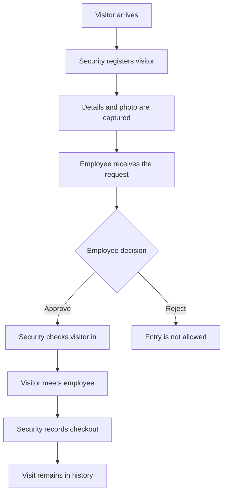
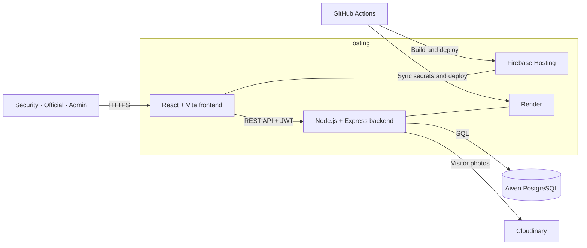

<p align="center">
  
</p>

<h1 align="center">Gate Entry Management System</h1>

<p align="center">
  A role-based visitor management platform for registration, employee approval,
  gate check-in, checkout, and administrative reporting.
</p>

<p align="center">
  <a href="https://github.com/Piyush3558/GATE-ENTRY-SYSTEM/actions/workflows/frontend.yml">
    
  </a>
  <a href="https://github.com/Piyush3558/GATE-ENTRY-SYSTEM/actions/workflows/backend.yml">
    
  </a>
  
  
  
</p>

<p align="center">
  <a href="https://gate-entry-d7d24.web.app"><strong>Open the web app</strong></a>
  ·
  <a href="https://gate-entry-system-uqjv.onrender.com"><strong>Check API status</strong></a>
</p>

---

## What it does

The Gate Entry Management System replaces manual visitor registers with a structured digital workflow. Security staff create a visitor request and capture a photo, the selected employee reviews the request, and the gate records the visitor's arrival and departure. Administrators can monitor activity, search historical records, and manage employee access.

The application was developed as part of a software development internship at UFI Filters.

## User roles

| Role | Capabilities |
| --- | --- |
| **Security** | Register visitors, capture photos, select the employee to visit, edit pending entries, check approved visitors in, and record checkout. |
| **Official / Employee** | View assigned visitor requests, inspect visitor details, approve requests, or reject them with a reason. |
| **Administrator** | View dashboard metrics, search and filter visitor history, inspect complete records, and manage employee accounts and access. |

## Main features

- Unified login with role-based routing and JWT session validation
- Visitor registration with contact, address, purpose, employee, and group-member details
- Camera capture or photo upload with Cloudinary storage
- Employee approval and rejection workflow
- Controlled check-in for approved visitors
- Checkout and visit-history tracking
- Department and employee directory integration
- Administrative dashboard with search, filters, pagination, and detailed records
- Employee account provisioning, activation, and password-management controls
- Responsive interfaces for security, employees, and administrators
- Automated secret scanning, dependency auditing, builds, and deployments

## How a visit moves through the system



## Architecture



### Production services

| Layer | Service | Purpose |
| --- | --- | --- |
| Frontend | Firebase Hosting | Serves the React single-page application over HTTPS. |
| Backend | Render | Runs the Express REST API. |
| Database | Aiven PostgreSQL | Stores accounts, employees, visitors, approvals, and entry history. |
| Media | Cloudinary | Stores visitor photos outside the ephemeral backend filesystem. |
| Automation | GitHub Actions | Validates changes and deploys the frontend and backend independently. |

## Technology stack

| Area | Technologies |
| --- | --- |
| Frontend | React 19, Vite 8, React Router, Axios, SheetJS, CSS |
| Backend | Node.js 22, Express 5, PostgreSQL client, JWT, bcrypt, Multer |
| Data | PostgreSQL 18 |
| Media | Cloudinary |
| CI/CD | GitHub Actions, Gitleaks, npm audit |
| Hosting | Firebase Hosting and Render |

## Project structure

```text
gate-entry-system/
├── .github/
│   ├── dependabot.yml
│   └── workflows/
│       ├── backend.yml
│       └── frontend.yml
├── backend/
│   ├── config/          # PostgreSQL and Cloudinary clients
│   ├── controllers/     # Authentication and domain operations
│   ├── middleware/      # JWT authorization and photo uploads
│   ├── routes/          # Express API routes
│   ├── .env.example
│   └── server.js
├── frontend/
│   ├── public/          # Public images and favicon
│   ├── src/
│   │   ├── components/  # Role-specific screens and layouts
│   │   └── services/    # Axios API client
│   ├── .env.example
│   ├── firebase.json
│   └── vite.config.js
├── package.json         # Render monorepo entry point
└── README.md
```

## Local development

### Prerequisites

- Node.js 22 or newer
- npm
- A PostgreSQL database with the application schema
- A Cloudinary account for visitor-photo uploads

### 1. Clone the repository

```bash
git clone https://github.com/Piyush3558/GATE-ENTRY-SYSTEM.git
cd GATE-ENTRY-SYSTEM
```

### 2. Configure and start the backend

```bash
cd backend
cp .env.example .env
npm ci
npm start
```

Set the following values in `backend/.env` before starting:

| Variable | Description |
| --- | --- |
| `PORT` | Local API port, normally `5000`. |
| `DATABASE_URL` | PostgreSQL connection string. |
| `DB_SSL` | Enables TLS for the database connection. |
| `DB_SSL_REJECT_UNAUTHORIZED` | Controls database certificate verification. |
| `JWT_SECRET` | Long, random key used to sign login tokens. |
| `CLOUDINARY_CLOUD_NAME` | Cloudinary product-environment name. |
| `CLOUDINARY_API_KEY` | Cloudinary API key. |
| `CLOUDINARY_API_SECRET` | Cloudinary API secret. |

The backend starts at `http://127.0.0.1:5000`. Its health endpoint is `/`, and the API is served below `/api`.

### 3. Configure and start the frontend

Open a second terminal:

```bash
cd frontend
cp .env.example .env
npm ci
npm run dev
```

For local development, set:

```env
VITE_API_BASE_URL=http://127.0.0.1:5000/api
```

Vite prints the local frontend URL after startup.

> [!IMPORTANT]
> Never commit `.env` files, database exports, service-account JSON files, API keys, passwords, or production visitor data.

## API overview

| Prefix | Responsibility |
| --- | --- |
| `/api/auth` | Shared login, current session, and password changes |
| `/api/visitors` | Visitor creation, listing, editing, check-in, checkout, and details |
| `/api/employees` | Departments and employee lookup |
| `/api/official` | Assigned requests and employee approval or rejection |
| `/api/admin` | Dashboard metrics and visitor reporting |
| `/api/admin/access` | Employee imports, accounts, access, and audit history |

Protected endpoints expect a bearer token:

```http
Authorization: Bearer <token>
```

## Data model

The PostgreSQL database separates operational records from authentication and audit data:

- `departments` and `employees`
- `visitor_entries` and `visitor_group_members`
- `security_accounts`, `official_accounts`, and `admin_accounts`
- `admin_audit_logs`

The repository expects these tables to exist before the backend starts. Production data is not stored in Git.

## Validation commands

Run these before opening a pull request:

```bash
# Frontend
cd frontend
npm ci
npm run lint
npm run build

# Backend
cd ../backend
npm ci
npm run check
npm audit --omit=dev --audit-level=high
```

## CI/CD

The repository has independent workflows so each service deploys only when its own files change.

### Frontend pipeline

1. Scans the repository for committed secrets.
2. Installs locked dependencies.
3. Audits production packages.
4. Lints and builds the Vite application.
5. Deploys the `frontend/dist` bundle to Firebase Hosting.

### Backend pipeline

1. Scans the repository for committed secrets.
2. Installs and audits locked dependencies.
3. Checks the syntax of every backend JavaScript file.
4. Synchronizes runtime secrets from GitHub Actions to Render.
5. Deploys the exact commit that passed validation.

Deployment credentials live in GitHub Actions Secrets. Public deployment configuration lives in GitHub Actions Variables. Secret values are never stored in the repository.

## Security design

- Passwords are hashed with bcrypt.
- JWTs protect role-specific routes.
- The backend verifies the current session before protected frontend routes render.
- Administrator endpoints enforce the administrator role server-side.
- Visitor photos are validated in memory and uploaded directly to Cloudinary.
- CI scans commits with Gitleaks and checks dependencies with `npm audit`.
- Firebase Hosting adds HTTPS, caching rules, content-security policy, and browser security headers.

## Contributors

- [Piyush3558](https://github.com/Piyush3558)
- [Kashish Verma](https://github.com/kashishverma0902-cmyk)

---

<p align="center">
  Built to make every visitor request traceable from the gate to checkout.
</p>
